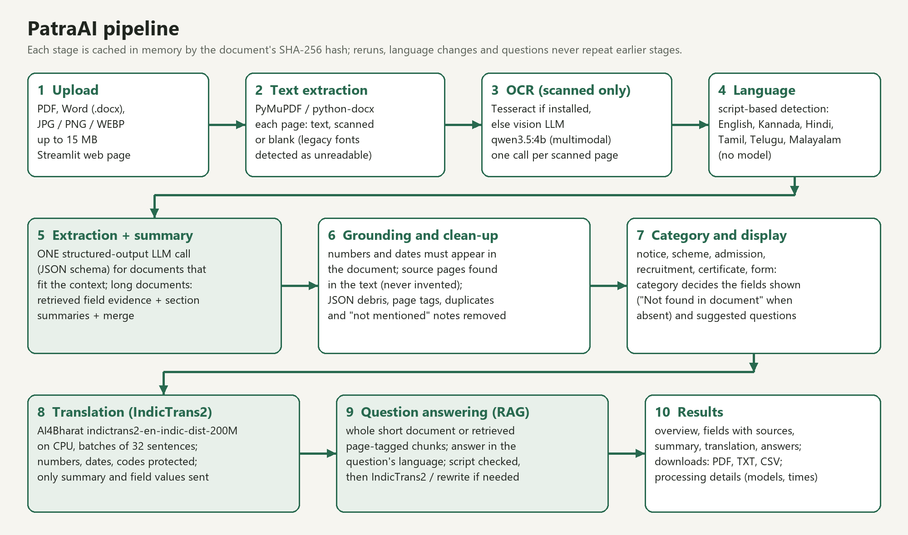
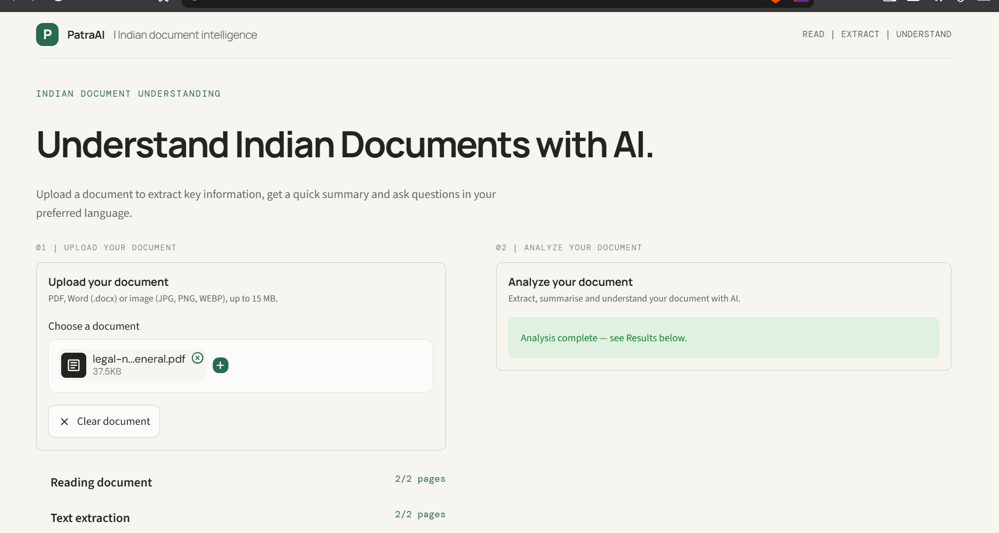
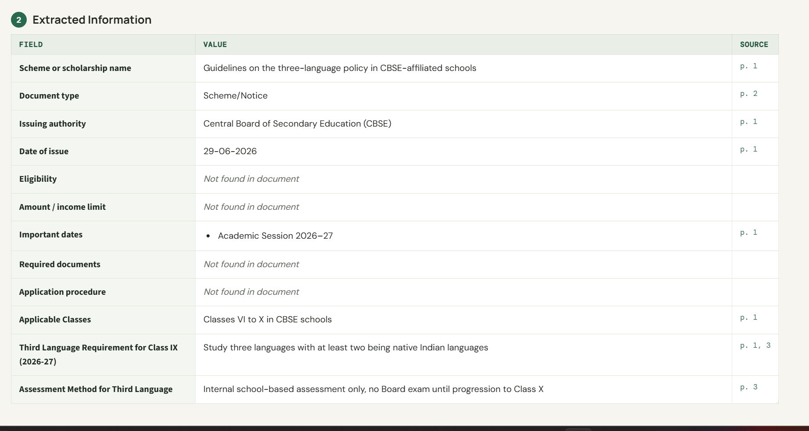
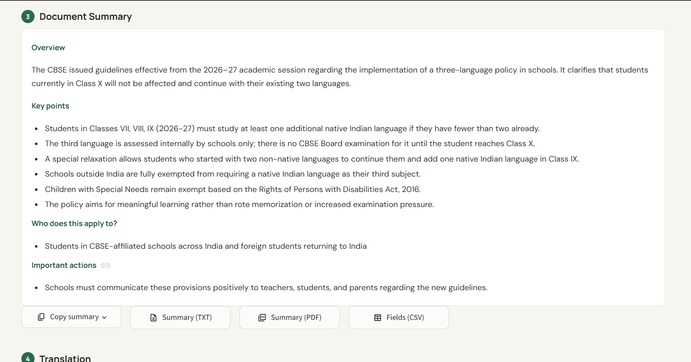
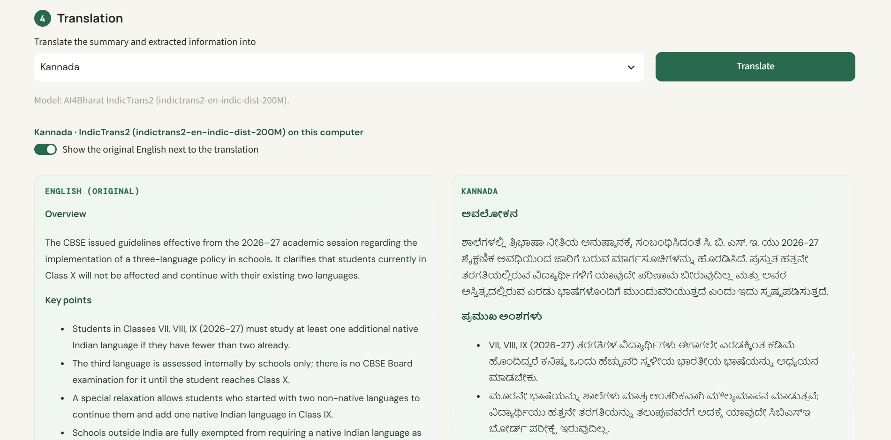

# PatraAI

**Author:** Pavan Kumar K N (1RVU23CSE331) · **Course:** CS3235 · **Report:** [docs/PatraAI_CS3235_Report.pdf](docs/PatraAI_CS3235_Report.pdf) ([Word](docs/PatraAI_CS3235_Report.docx))



PatraAI is a CS3235 project, the **Indian Document Understanding Tool**: a general-purpose application for Indian notices, circulars, forms, certificates, brochures, letters, scheme documents and other documents. It works on any uploaded document; nothing is tied to a particular document, template or department. The project sheet specifies BharatGen Patram (vision-language model) and AI4Bharat IndicTrans2 as models, and **field-extraction accuracy and QA accuracy** on 30–50 representative test cases with failure analysis as the evaluation.

**Website** (one page):

- **Upload:** PDF, Word (.docx) or image (JPG, PNG, WEBP), up to 15 MB. A preview has a page selector for PDFs and an outline for Word files, and a **Clear document** button.
- **Results** (in this order, with jump links): Document Overview · Extracted Information · Document Summary · Translation · Ask Questions · Processing Details.
- **Response language:** Automatic, English, Kannada, Hindi, Tamil, Telugu or Malayalam. In Automatic mode the overview, fields and summary follow the document's own language (detected from its script), and **each answer follows the language of its own question** (see [Multilingual question answering](#multilingual-question-answering)). An explicitly chosen language applies to everything, answers included. Changing it never re-reads the document.
- **Downloads:** copy and download the summary (TXT or PDF), extracted information (CSV) and **all results as a PDF** (overview, extracted information with sources, summary, translations, and questions and answers with their sources, in the language shown, with Indian-script fonts). Answers can be copied.
- **Footer:** Privacy Policy and Terms & Conditions.

**Academic evaluation:** a separate developer dashboard (**Evaluation Dashboard.bat**) and command-line runner over a 45-case benchmark of 18 real public documents. It is not part of the website. See [Evaluation](#evaluation-field-extraction-accuracy-and-qa-accuracy).

## Screenshots

| Upload | Extracted information |
| --- | --- |
|  |  |
| **Summary** | **Translation (IndicTrans2)** |
|  |  |

## Run the application

On Windows, double-click **Start PatraAI.bat** (or **Run Indian App.bat**, which works the same way). It checks dependencies, stops any older PatraAI server started from this folder, starts Streamlit, waits for the health check and opens the browser. Keep the window open while using the app. Close it, or double-click **Stop PatraAI.bat**, to stop the app. In VS Code, **Ctrl+Shift+B** runs the "Run PatraAI" task, and "Tasks: Run Task → Stop PatraAI" stops it.

From PowerShell in this folder, you can also run:

```powershell
py -3.11 run_app.py
```

The launcher uses the current Python interpreter, installs packages from `requirements.txt` if required, starts the local Ollama service when present, downloads the required local models if they are missing, and prints the local URL. `Indian.py` can also be used directly. The upload limit is 15 MB; the PDF page count is not capped.

## Model setup

### Local Ollama defaults

One model, `qwen3.5:4b` (3.4 GB), handles document text, scanned-page OCR and the translation fallback. It was chosen after measuring this laptop: with other apps open, only about 6 GB of its 15 GB RAM is free. `gemma4:e4b` (9.6 GB) does not fit, so every request paged to disk, and loading two models at once caused swapping. On the same brochure, `qwen3.5:4b` gave comparable fields and summaries. If a generation fails (a repetitive-token abort or the output limit), the request is retried once with `OLLAMA_FALLBACK_MODEL` (default `gemma4:e4b`, optional), and the result reports which model answered. The fallback model is unloaded right after that request, so it never stays in memory beside `qwen3.5:4b` (kept loaded together, they left under 1 GB free and slowed every later call). Install Ollama and pull the model once; the launcher does this automatically:

```powershell
ollama pull qwen3.5:4b
```

### BharatGen Patram (vision-language model)

Patram-7B needs a GPU inference server. It cannot practically run on the project laptop: 15 GB RAM and no GPU, while the 7B model needs about 15 GB in bf16 for its weights alone. The sheet itself asks you to "confirm ... GPU requirements, and suitability before assigning a model". So:

- When `HF_CHAT_COMPLETIONS_URL` points to a running Patram deployment (an OpenAI-compatible chat endpoint, for example vLLM on a GPU machine or a Hugging Face Inference Endpoint), PatraAI sends field extraction, summaries, question answering and scanned-page reading to Patram. Set `PATRAM_MODEL`, and `HF_TOKEN` if the endpoint needs it.
- When it is not configured, the same pipeline runs on the local multimodal model `qwen3.5:4b` through Ollama, for both scanned-page vision OCR and text. The Processing details panel in each result names the models that actually answered and states that Patram was not configured. The app never claims Patram was used unless the endpoint reports a Patram model.

### AI4Bharat IndicTrans2 (translation)

Translation of the summary, extracted fields and answer into **Kannada, Hindi, Tamil, Telugu and Malayalam** uses IndicTrans2, in this order:

1. **IndicTrans2 service**, if `INDIC_TRANS2_URL` is set. It is called with a JSON POST of `text`, `source_language_code` and `target_language_code`.
2. **Local IndicTrans2** (`ai4bharat/indictrans2-en-indic-dist-200M`, about 1 GB, runs on CPU with transformers). The official IndicTransToolkit preprocessing is ported to pure Python in `indictrans2_processor.py`, so no C compiler is needed. This includes protecting numbers, dates and emails, and transliterating Devanagari output into the target script.
3. **Fallback**: only if IndicTrans2 cannot run, the general local model translates. The page shows a visible notice with the reason.

One-time setup for local IndicTrans2 (the model is gated on Hugging Face):

1. Sign in at huggingface.co and open https://huggingface.co/ai4bharat/indictrans2-en-indic-dist-200M. Accept the access conditions.
2. Create a **Read** access token (Settings → Access Tokens).
3. Add it to `.env` in this folder: `HF_TOKEN=hf_...`
4. Start PatraAI. The launcher installs `requirements-indictrans2.txt` if needed and downloads the model once.

## Document processing

Processing runs in independent stages. Each stage's result is cached in memory by the document's SHA-256 content hash together with a fingerprint of the analysis configuration (models, context size, budgets and prompt version), so Streamlit reruns, browser refreshes and follow-up questions never repeat earlier stages, and a configuration change never shows results made under the old one. Every model reply that succeeded is kept while an analysis is unfinished: if a call fails or a rerun interrupts the run, analyzing again repeats only the missing calls. Failed or empty replies are never stored as results.

| Stage | What it does | Model calls |
| --- | --- | --- |
| Reading and text extraction | PyMuPDF reads the selectable text of every page and classifies each page once as **text**, **scanned** (a large image or visible ink with little selectable text, or an unreadable text layer) or **blank**. Many Indian government PDFs use legacy non-Unicode fonts (Nudi, Baraha, ML-TT), whose text extracts as gibberish such as `aEPAR:rilEilT`; such pages are detected and sent to OCR instead. | none |
| Scanned-page OCR | Only scanned pages are rendered and read, one page per call, by Tesseract (if installed) or the vision model. Results are cached per page, so an interrupted run resumes. | one per scanned page |
| Information extraction + summary | Documents that fit the model's context (up to `SINGLE_CALL_TOKENS` estimated tokens, measured per script, so Indian-language documents are not penalised by a fixed character limit) are analyzed in **one** call that returns the fields and the summary together. With Ollama the reply is decoded against a JSON schema (structured outputs), so the summary cannot be missing and list items are plain text. An empty part is requested on its own (a targeted fallback, not a rerun). Longer documents use one field-extraction call over passages selected for title/issuer, dates, fees, eligibility, documents, procedure and instructions (always including page 1). Dates of issue and deadlines must be printed in the document, and values whose numbers do not appear in the text are left out (listed in Processing details). | 1 (2 if a part is empty) |
| Summary generation (long documents) | Long documents are split into at most `SUMMARY_MAX_SECTIONS` contiguous sections covering every page. Each section is summarized from its most informative passages, then the section summaries are merged into the concise summary. An empty merge is asked once more; if it is still empty the summary is reported as failed, never shown as done. | sections + 1 |
| Question answering | Short documents (up to `QA_FULL_CONTEXT_CHARS` and `QA_FULL_CONTEXT_PAGES`) are given to the model whole; long ones are reduced to the page-tagged chunks (overlapping by `QA_CHUNK_OVERLAP`) retrieved for the question. Exact amounts, dates and codes are quoted from the text. The document is never re-processed for a question. | 0–2 |

**Summary.** The Document Summary is short and explains the document's meaning instead of repeating the extracted values: an **Overview** (2 sentences: what the document is, who issued it, its purpose), **Key points** (the important rules, changes, conditions and exceptions, one sentence each), **Who does this apply to?** and **Important actions**. Dates are listed once, in Extracted Information (each important date with its event). Parts the document does not support are left out, and so are model notes about what a document does not say ("No eligibility criteria were detailed…"), JSON fragments and near-identical points. The target length follows the document's size (about 50–80 words for short documents, 70–110 for medium and 100–150 for long ones) and is a guide, not a limit: important conditions and deadlines are kept.

**Extracted values are clean.** Page references are separated from values and shown only in the Source column (`…; Page: 2`, `Page 2: …`, `(p. 3)`, `{"condition": …, "page": 2}` all become the plain value with its page as source). Source pages are found in the document text, not taken from the model: the model's page numbers were often wrong (page 0, or page 4 of a one-page order), and a page outside the document is never shown. Page, section and footer references are never listed as required documents, duplicate values are kept once (also across fields), and additional fields that only repeat a field above are dropped.

The overview and the extracted information show the same validated values: one document type is kept for both. Which fields are listed depends on the document's category (notice or circular, scholarship or scheme, admission brochure, recruitment, certificate, form): a category's key fields are always shown, with "Not found in document" when absent, and other fields only when the document states them. Model output is cleaned before display, so raw JSON keys, Python lists and empty arrays (for example `required_documents: []`) never appear.

### Multilingual question answering

1. The question's language is detected from its script (Kannada, Devanagari/Hindi, Tamil, Telugu, Malayalam) or, for romanised questions such as `ee dakhaleyannu yaaru horadisiddare?`, from distinctive words.
2. The answer language is the explicitly selected response language; in Automatic mode it is the question's language, never the document's. A question with no recognisable language (for example `2026?`) keeps the previous answer's language.
3. The evidence is the whole document (short documents) or retrieved passages. To search a long document, a non-English question is translated to English by the analysis model (the translation is rejected if the model answered instead of translating), and for Indian-language documents also into the document's language with IndicTrans2. Indian-script words are matched on their stem, so case endings do not prevent a match.
4. The model is told the required response language, after the document text (so the prompt prefix is identical for follow-up questions and Ollama reuses it).
5. The answer's script is then checked in code. An English answer that should be in an Indian language is translated with IndicTrans2, keeping bullets and bold markers; any other mismatch (for example a Hindi answer to a Kannada question) is rewritten once by the analysis model, because IndicTrans2 here translates from English only. If the answer still is not in the required language, an error is shown instead of a wrong-language answer.
6. Each answer shows the question language, the answer language, its source pages and its measured time. Answers are cached per question and language, so repeating a question or switching back to a language costs no model call.

The interface shows only the stages that are actually running (for example, `Scanned-page OCR: 1/1 pages`). Field values, answers and summaries keep their page references. A blank page is reported as blank and is not sent to a model.

All model requests use one fixed context size (`OLLAMA_NUM_CTX`, default 8192), so Ollama does not reload the model between calls. Requests have a connect timeout and a per-request timeout (`MODEL_TIMEOUT_SECONDS`). Before a long analysis starts, the app checks that the local model service is running and reports a clear error if it is not.

### Measured performance (CPU-only laptop, local Ollama `qwen3.5:4b`)

Measured on this project's laptop (AMD Ryzen 7 7735U, 15 GB RAM, no GPU), 3–4 November 2026, with the same five benchmark documents, the same models and the same timing script for both versions. Before each analysis an unrelated request replaced Ollama's cached prompt, so neither version benefited from the other. Translation is measured cold (empty translation cache, IndicTrans2 already loaded). On this CPU the model reads about 55 prompt tokens/s and writes about 9 tokens/s, so both the prompt and the reply length matter.

| Document | Analysis before → after | Kannada translation | Hindi translation | Fields correct |
| --- | --- | --- | --- | --- |
| Telangana government order (1 page) | 76.1 → 57.6 s | 24.3 → 15.7 s | 18.8 → 16.6 s | 2/2 → 2/2 |
| CBSE press release (4 pages) | 106.9 → 83.7 s | 28.7 → 18.9 s | 30.2 → 17.0 s | 3/3 → 3/3 |
| CS3235 project sheet (Word, 9 sections) | 91.8 → 77.9 s | 65.1 → 19.6 s | 55.8 → 20.6 s | 1/2 → 1/2 |
| AP scheme order (7 pages) | 194.7 → 148.0 s | 53.9 → 27.9 s | 50.4 → 33.9 s | 2/3 → 2/3 |
| Hindi circular (7 pages) | 148.6 → 109.1 s | 25.6 → 9.6 s | 27.2 → 11.1 s | 2/3 → 2/3 |
| **Total** | **618 → 476 s (−23%)** | **380 → 191 s for both languages (−50%)** | | **10/13 → 10/13** |

What changed, and why it is faster:

- **Shorter model reply.** Source pages are no longer written by the model (they are found in the document text), dates are written once (in the fields, not again in the summary), and the summary is shorter. Output tokens fell by 9–45% per document (for example 1,001 → 671 on the AP order).
- **Shorter instructions.** The analysis instructions were rewritten from about 1,076 to about 784 tokens with every accuracy rule kept.
- **IndicTrans2 batches of 32 instead of 8.** On 98 real summary and field sentences: 109 s with batches of 8, 74 s with 24, 71 s with 48 and 113 s with 96 (more padding), with identical output. More CPU threads made no difference (118 s with 15, 116 s with 8).
- **Interface labels are translated once, ahead of time** (`indictrans2_labels.json`, made by the same IndicTrans2 model with `evaluation/build_label_translations.py`), and the suggested questions are translated in the same batch as the results.
- **Prompt read ahead.** While the user looks at the preview, the model already reads the analysis prompt of a document with selectable text; after analysis, it reads the question-answering prompt (rules and the whole short document) while the user reads the results. A request that arrives early waits for that read and reuses it, so this never makes a step slower.
- **No memory thrashing.** The 9.6 GB fallback model is unloaded right after its one request; kept beside `qwen3.5:4b` it left under 1 GB of RAM free and slowed every later call.

Nothing is repeated on reruns, language changes or follow-up questions: text, OCR, analysis, translations and answers are cached per document hash in memory.

## Privacy and terms

**Privacy Policy** and **Terms & Conditions** are expandable sections in the page footer. The privacy section describes what this installation does. It detects whether the configured analysis and translation services are on this computer or external, without showing URLs or settings. In summary:

- Uploaded originals are not written to disk. Extracted text, OCR text and results are kept in memory for up to 8 recent documents and are cleared when the app stops or restarts.
- With the default configuration, all model processing happens on this computer. If `HF_CHAT_COMPLETIONS_URL` or `INDIC_TRANS2_URL` points to another machine, the privacy section says that document content is sent to an external service.
- The website does not save anything from users. The evaluation dataset and its results live in `evaluation/dataset/` and `evaluation/results/` and are part of the repository.
- Streamlit usage statistics are disabled in `.streamlit/config.toml`.

## Evaluation (field-extraction accuracy and QA accuracy)

The evaluation is a **developer workflow, separate from the website**. Open it with **Evaluation Dashboard.bat** (http://127.0.0.1:8502), or use the command line:

```powershell
py -3.11 evaluation/run_evaluation.py            # run pending test cases, then write the report
py -3.11 evaluation/run_evaluation.py --failed   # re-run only failed cases
py -3.11 evaluation/run_evaluation.py --rerun    # evaluate every test case again
py -3.11 evaluation/run_evaluation.py --report   # rebuild the report from saved results
```

- **Benchmark:** 45 test cases over **18 independent real public documents** in `evaluation/dataset/`. Languages: English, Hindi, Kannada, Tamil, Malayalam, and English + Punjabi. Categories: admission brochure, press release, circulars, scholarship notification, scheme order, policy document, gazette, government order, proceedings, certificate format, application forms and an educational document. Formats: searchable, scanned, mixed, legacy-font PDF, a long 83-page PDF, JPG image and Word. Each case has verified expected fields with pages, a question, a verified answer and its page or section, plus the source of the document. Two derived files are labelled: a 3-page excerpt and a JPG of one page. No document was constructed and no expected value came from the model. **Telugu documents are not covered**, because no Unicode Telugu government document was found. See [evaluation/dataset/README.md](evaluation/dataset/README.md).
- **Dashboard:**
  - four metric cards: total test cases, field-extraction accuracy, QA accuracy and page-reference accuracy, each with its numerator and denominator
  - evaluated, pending and failed cases, processing errors, the last run date and the model
  - breakdowns by language, category, format and model, as tables and charts
  - failure categories: incorrect value, missing field, incorrect answer, abstention, unsupported or hallucinated information, wrong page, OCR failure, processing error
  - an inspector showing the original page beside the expected and predicted values
  - run pending, re-run failed, re-run all
  - JSONL import of more verified cases
  - Markdown, CSV and JSON export
- **Scoring** (`evaluation/scoring.py`, also explained on the dashboard): normalized matching for values, where case, spacing, punctuation and date or amount formats don't matter but numbers must be identical. Longer answers also accept a paraphrase with content-word F1 ≥ 0.7 and recall ≥ 0.75, with identical numbers. Page-reference accuracy is scored separately. Model confidence is never used.
- **Outputs:** `evaluation/results/CS3235-evaluation-report.md`, `evaluation-results.csv` and `evaluation-results.json`. They contain only results from completed runs, and a partial run is labelled as such.

### Results (all 45 test cases, `qwen3.5:4b` on a CPU-only laptop)

| Metric | First run | After fixes |
| --- | --- | --- |
| Field-extraction accuracy | 64.4% (29 of 45) | **75.6%** (34 of 45) |
| QA accuracy | 66.7% (30 of 45) | **77.8%** (35 of 45) |
| Answer cited the correct page | 66.7% | 77.8% |
| Processing errors | 0 | 0 |

The failure analysis of the first run showed that scanned Kannada and Malayalam pages were the main cause of errors. Two fixes followed: scanned pages are now read with Tesseract OCR and Indian-language packs (the page's script is detected first; the vision model is the fallback), and the date check understands Indian-language month names. The 11 cases on the four affected documents were run again; the other 34 keep their first-run results (`evaluation/results/first-run/` holds the first run). Remaining errors are mostly long documents where the right page is not retrieved. Details are in the [project report](docs/PatraAI_CS3235_Report.pdf), Chapter 5.

**Tesseract setup (optional, recommended):** install Tesseract (for example `winget install UB-Mannheim.TesseractOCR`), download the `hin`, `kan`, `tam`, `tel`, `mal` and `pan` models from [tessdata_best](https://github.com/tesseract-ocr/tessdata_best) into a folder with `eng` and `osd`, and set `TESSDATA_PREFIX` (and `TESSERACT_CMD` if Tesseract is not on PATH) in `.env`.

Other command-line checks:

```powershell
py -3.11 evaluation/run_pdf_samples.py
py -3.11 evaluation/run_translation_samples.py
py -3.11 -m pip install -r requirements-dev.txt
py -3.11 -m pytest -q
```

## Current limitations

- Patram is not configured, because it needs a GPU server (see above). The pipeline uses it automatically when a Patram endpoint is set. IndicTrans2 is installed and verified locally for all five target languages.
- The benchmark has no Telugu document: no public Unicode Telugu government document was found, so Telugu *document understanding* is not measured (Telugu translation and Telugu questions are tested). Tamil (3 cases) and Malayalam (2 cases) are covered by few cases.
- IndicTrans2 is installed for English → Indian languages only. Answers that must change between two Indian languages, or from an Indian language into English, are rewritten by the analysis model instead, and the answer's language is checked afterwards.
- Scanned Indian-language pages: without Tesseract, OCR is done by the `qwen3.5:4b` vision model. Measured on a scanned Kannada notice, it read the digits and dates correctly but garbled most Kannada words (for example "ವಿಭಾಗ: ಶಿಕ್ಷಣ ಇಲಾಖೆ" became "ವೈಭಾಗ: ಕಳಿಯಾಲ ಅಲಾಮಿ"), so names and authorities extracted from such pages are unreliable. Installing Tesseract with Indian-language packs (see Results above) makes PatraAI use it automatically for scanned pages; this raised accuracy in the evaluation.
- Romanised-question detection uses word lists. Short or unusual romanised questions may be detected as English; choose the response language explicitly in that case.
- The app limits uploaded files to 15 MB. Model calls are sequential to keep CPU and memory use bounded. On a CPU-only computer each call takes roughly 30–130 seconds, so a long document takes several minutes, and every scanned page needs one extra call.
- For long documents, the summary is built from each section's most informative passages, not every sentence. Specific details are answered through question retrieval, which searches all pages.
- Field extraction for long documents reads selected passages. A field stated only in passages that were not selected can be missed; ask a question to look it up.

## References

- [BharatGen Patram model card](https://huggingface.co/bharatgenai/patram-7b-instruct)
- [AI4Bharat IndicTrans2 repository](https://github.com/AI4Bharat/IndicTrans2)
